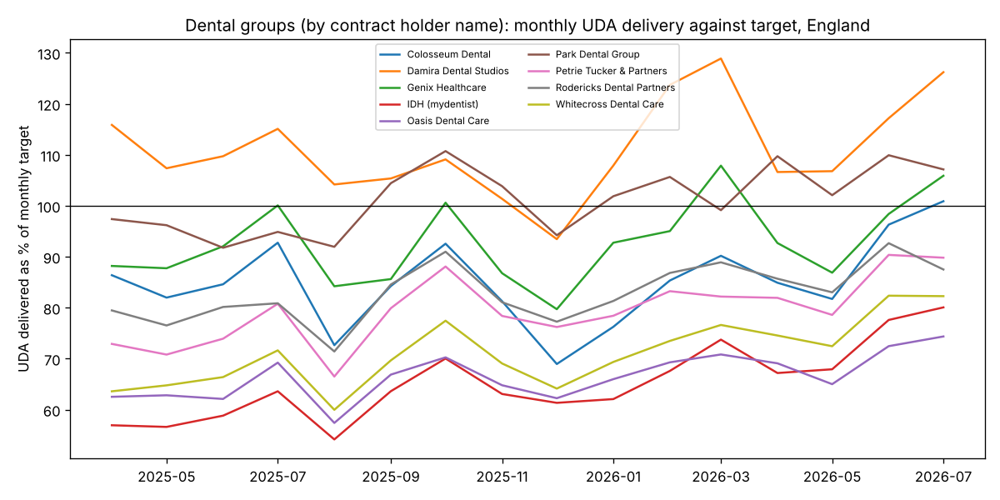

# Dental Performance Data Platform

An ELT pipeline that turns real NHS dental open data into one agreed set of
practice and group performance measures, using dlt for ingestion, Dataform
SQL models for BigQuery, and tests that reconcile every figure back to the
source files.

It answers the questions a multi-clinic dental group's operations and finance
teams ask every month: how much treatment each practice delivered, how that
compares with its contract, what the delivered activity is worth, and which
practices are falling behind. It is built so a new practice, a renamed
company or a changed file format becomes a reviewed change to a rule, not a
silent break in a report.



## The data

Real, published data from the NHS Business Services Authority Open Data
Portal, licensed under the Open Government Licence 3.0
("NHSBSA Copyright 2023-2026"):

| Source | Grain | Files used |
|---|---|---|
| English Contractor Monthly General Dental Activity | contract by month | 16 months, Apr 2025 to Jul 2026 |
| English Contractor Monthly General Dental and Orthodontic Contractual Dataset | contract line by snapshot | Mar 2025, Mar 2026, Jul 2026 |

That is 108,785 contract months across 7,288 NHS dental contracts in England.
The files are in `data/raw/` exactly as downloaded on 14 Nov 2026, so every
run and every CI build works from the same real inputs.
`ingestion/download.py` fetches newer months from the portal's API.

There is no public source for a private dental group's own appointments,
invoices and payments, so this project uses the closest real equivalent:
courses of treatment, Units of Dental Activity (UDAs) and contract values
per practice.

## What the source data gets wrong, and what the pipeline does about it

All of these were found by profiling and testing the real files, and each is
covered by a test or an assertion. Details are in
[docs/data_issues.md](docs/data_issues.md).

| Found in the files | Handling |
|---|---|
| Apr and May 2025 files are Windows-1252, not UTF-8 | Decode with fallback, record the encoding per file in a manifest, raise an exception row |
| Column renames in Apr 2026 (`LSOA11_CODE` to `LSOA21_CODE`, `BAND_URGENT_DELIVERED` to `BAND_UNSCHEDULED_DELIVERED`) and `YEAR_MONTH` switching from `202603` to `2026-04` | Land everything as text with dlt schema evolution, reconcile names and formats in one staging model |
| Header quirks (`"BAND_2A_DELIVERED "` with a trailing space, mixed quoting) | Trim and lower case headers at read time |
| Contract dates switch from `dd/mm/yyyy` to `yyyy-mm-dd` | Parse both, test both |
| 3,770 contract months listed with a target but every activity field blank | Keep, flag `activity_reported = false`, count as zero UDAs against target |
| Dental school and trust contracts with a UDA target of 1 against millions of pounds (value per UDA of £2.4m) | Configurable rule (`min_real_uda_target`, value per UDA range) excludes them from delivery % and value, lists them for review |
| 42 commissioners merged into 36 ICBs in Apr 2026; 2,457 contracts changed holder, commissioner or postcode | SCD Type 2 contract history, so reports group each month under the right owner |
| NHSBSA republishes corrected months (Apr and May 2026 were corrected in Sep 2026) | Merge on contract and month, so a corrected file replaces the earlier load |

## Architecture

```
NHSBSA Open Data Portal (CSV, CKAN API)
        |  ingestion/download.py
        v
data/raw/*.csv
        |  dlt (ingestion/pipelines.py): decode, trim headers, merge, file manifest
        v
raw_nhsbsa            activity_monthly, contract_snapshots, file_manifest
        |  Dataform (dataform/definitions)
        v
dental_staging        stg_activity, stg_contract_snapshots, ref_provider_group
dental_marts          fct_contract_month, dim_contract_history (SCD2), dim_contract, dq_exceptions
dental_reporting      rpt_group_monthly, rpt_contract_financial_year
        |
        v
Looker Studio (reads dental_reporting)
```

* **Ingestion:** dlt, DuckDB locally and in CI, BigQuery with
  `DENTAL_DESTINATION=bigquery`.
* **Transformation:** Dataform SQLX in BigQuery SQL, with built in assertions
  (unique keys, not null, row conditions) on every model plus six custom
  reconciliation assertions.
* **Rules as data:** dental group mapping is a reference table and the
  thresholds live in `workflow_settings.yaml`, so business rules are reviewed
  in one place.

## Measures

One definition each, written down in
[docs/metric_definitions.md](docs/metric_definitions.md): courses of
treatment, UDAs delivered, UDA target to date, delivery %, value per UDA,
value of UDAs delivered, UDA shortfall and delivery band.

Headline results from the current run, FY2025-26 (April 2025 to March 2026,
complete):

* 72.5 million UDAs delivered against 80.5 million contracted, **89.4%**.
* 2,817 contracts finished below 96% of target, with an estimated
  **£349.1 million** of contracted UDAs not delivered (shortfall valued at
  each contract's own value per UDA).
* Median value per UDA: £34.95.

These are estimates from published management information, not official
statistics or contract reconciliations.

## Testing

* **22 Dataform assertions** run after every build, including:
  * row counts reconciled to each source file;
  * UDAs reconciled month by month to the raw files;
  * no missing months;
  * every numeric field parses;
  * SCD2 history has exactly one current version with no overlaps;
  * both reports tie back to the fact table.
* **12 pytest tests**, including:
  * an independent recalculation of FY2025-26 UDAs from the CSVs in plain
    Python;
  * tests for each data issue above;
  * a reload test proving reruns do not duplicate rows.
* **GitHub Actions** runs the whole pipeline and every test on each push.

## Run it

```bash
pip install -r requirements.txt
npm install                      # Dataform CLI
python scripts/run_local.py      # load, build, assert, write output/
pytest -q
```

`run_local.py` compiles the Dataform project with the Dataform CLI, then runs
the compiled BigQuery SQL on DuckDB (translated with sqlglot) so the models
and assertions can be tested without a cloud account. On BigQuery the same
project runs unchanged with `dataform run`; see
[docs/deploy_bigquery.md](docs/deploy_bigquery.md).

## Limitations

* Dental groups are matched on the contract holder's name. Contracts held
  through differently named subsidiaries are counted as independent.
* Contract value comes from the activity file's `UDA_FIN_VAL`; the contract
  snapshot is used for contract dates only, because a contract can carry
  several lines per snapshot.
* NHS England data, not Australian, and no patient level or cash collections
  data.

## Licence

Code: MIT. Data: NHSBSA Open Data, Open Government Licence 3.0,
"NHSBSA Copyright 2023-2026".
